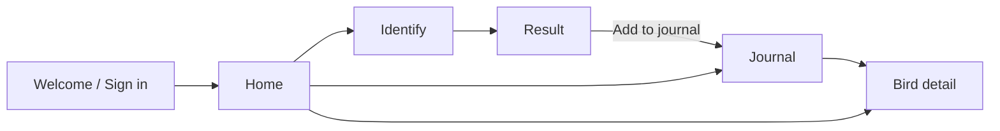

# Birdify — Developer Brief (source of truth)

> Verbatim transcription of `Birdify — Developer Brief.pdf`. Do not edit the requirements here;
> record deviations in [DECISIONS.md](DECISIONS.md) instead.

Birdify is an iOS + Android app: snap a photo of a bird, get the species in seconds, save it to a
personal journal. Photo ID ships in v1; sound ID is v2.

## Stack

One TypeScript codebase for both platforms: Expo (React Native) on the client, Firebase for
everything server-side.

| Layer    | Choice                                              |
| -------- | --------------------------------------------------- |
| App      | Expo SDK (latest stable) + Expo Router, TypeScript  |
| Auth     | Firebase Authentication, email/password             |
| Database | Cloud Firestore                                     |
| Photos   | Firebase Storage                                    |
| Server   | Firebase Cloud Functions (2nd gen, Node 20)         |
| Bird ID  | OpenAI vision model, called only from a Cloud Function |
| Builds   | EAS Build + EAS Submit (App Store, Play Store)      |

The OpenAI key never ships in the app. It lives as a Functions secret. Cloud Functions needs the
Firebase Blaze (pay-as-you-go) plan.

## Scope

v1 is one loop: sign in, photograph a bird, get the ID, save it, browse your journal.

**In v1:**

- Email/password sign up, log in, log out, password reset email; session persists across app restarts
- Capture with the camera or pick from the photo library
- Identify via the `identifyBird` function; result screen with species, scientific name, confidence, facts, summary
- Save a sighting (photo + ID data) to the journal
- Journal list with search by common or scientific name; bird detail screen
- Home: greeting, identify button, species count, sightings this week, 3 most recent

**Out of v1:**

- Sound ID (record a call, identify it). Show the Sound tab on the Identify screen with a "Soon" badge, disabled.
- Location tagging, sharing, social features, offline ID, subscriptions/paywall

## Screens and navigation

Six screens; the visual reference is the design canvas (link in the original PDF — not accessible
to Claude; screenshots to be placed in `docs/design/` if provided).



| Route             | Screen            | Notes                                                                  |
| ----------------- | ----------------- | ---------------------------------------------------------------------- |
| `/(auth)/sign-in` | Welcome / Sign in | Email + password, toggle to sign up, forgot password link              |
| `/(tabs)/index`   | Home              | Greeting, Identify card, stats, recent sightings                       |
| `/(tabs)/journal` | Journal           | 2-column grid, search field, newest first                              |
| `/identify`       | Identify          | Full-screen camera modal, shutter, gallery, flip camera, Photo / Sound (Soon) toggle |
| `/result`         | Result            | Photo on top, bottom sheet with ID data, Add to journal                |
| `/bird/[id]`      | Bird detail       | Photo, name, facts, summary, notes, seen date                          |

Tabs: Home and Journal, with a raised center camera button that pushes `/identify`. Signed-out
users are redirected to `/(auth)/sign-in` by a root auth guard.

## Data model and security rules

Everything lives under the signed-in user's uid; nothing is shared between users.

| Path                                          | Fields |
| --------------------------------------------- | ------ |
| `users/{uid}`                                 | displayName, email, createdAt, speciesCount |
| `users/{uid}/sightings/{sightingId}`          | species, scientificName, family, confidence (0–100), facts {sizeCm, diet, region, habitat}, summary, photoPath, notes, seenAt |
| Storage `users/{uid}/uploads/{uuid}.jpg`      | temp image sent for ID; the function deletes it when done |
| Storage `users/{uid}/sightings/{sightingId}.jpg` | saved sighting photo |

`speciesCount` = distinct `scientificName` values in sightings; update it in the save flow (client
transaction is fine for v1).

Firestore rules (as given in the brief; see DECISIONS.md D1 for the amendment):

```
rules_version = '2';
service cloud.firestore {
  match /databases/{db}/documents {
    match /users/{uid}/{doc=**} {
      allow read, write: if request.auth != null && request.auth.uid == uid;
    }
  }
}
```

Storage rules:

```
rules_version = '2';
service firebase.storage {
  match /b/{bucket}/o {
    match /users/{uid}/{all=**} {
      allow read, write: if request.auth != null && request.auth.uid == uid
        && (request.resource == null || (request.resource.size < 5 * 1024 * 1024
        && request.resource.contentType.matches('image/.*')));
    }
  }
}
```

## Identify function

`identifyBird` is an HTTPS callable function (`onCall`, 2nd gen) that takes a Storage path and
returns one structured JSON result.

**Client flow:**

1. Resize to max 1024 px on the long edge, JPEG quality 0.7 (expo-image-manipulator)
2. Upload to `users/{uid}/uploads/{uuid}.jpg`
3. Call `identifyBird({ imagePath })` and show a loading state on the Result screen
4. On Add to journal: upload the local image to `users/{uid}/sightings/{sightingId}.jpg` and write the sighting doc

**Function steps:**

1. Reject if unauthenticated or if `imagePath` does not start with `users/{auth.uid}/uploads/`
2. Rate limit: 50 calls per user per day (counter doc at `users/{uid}/meta/usage`)
3. Download the image, send it base64 to OpenAI with Structured Outputs (`json_schema`, strict)
4. Delete the temp file in a `finally` block; return the parsed JSON

Model name comes from env `OPENAI_MODEL` so it can change without a code edit; use a current
vision-capable OpenAI model.

**Response schema:**

```json
{
  "isBird": true,
  "species": "American Goldfinch",
  "scientificName": "Spinus tristis",
  "family": "Fringillidae",
  "confidence": 97,
  "facts": { "sizeCm": "11–13", "diet": "Seeds", "region": "North America", "habitat": "Meadows, gardens" },
  "summary": "2–3 sentence plain-language description.",
  "alternatives": [{ "species": "Lesser Goldfinch", "confidence": 2 }]
}
```

**System prompt (starting point):**

```
You are an expert ornithologist. Identify the bird in the image to species level.
If there is no bird, set isBird=false and leave other fields empty.
confidence is your honest 0-100 estimate. List up to 2 alternatives when unsure.
summary: 2-3 friendly sentences on appearance and behavior. No markdown.
```

**Error states the app must handle:**

| Case                                 | App behavior                                         |
| ------------------------------------ | ---------------------------------------------------- |
| `isBird = false`                     | "No bird found" card, Retake button                  |
| `confidence < 60`                    | Show top result + alternatives, label "Best guess"   |
| Rate limit hit (`resource-exhausted`) | "Daily limit reached, try tomorrow"                 |
| Network / function error             | Toast + Retry, keep the photo                        |

## Design spec

Match the design canvas: soft mint-to-sky gradients, deep forest text, warm yellow accents, calm
motion. Put these in `theme.ts` as the only source of colors and sizes.

| Token                 | Value                          | Use                                  |
| --------------------- | ------------------------------ | ------------------------------------ |
| ink                   | `#17271F`                      | Headings, primary text               |
| inkMuted              | `#5A6F64`                      | Body copy, labels                    |
| inkFaint              | `#8A9C92`                      | Dates, placeholders, inactive tabs   |
| bgTop / bgBottom      | `#F4FBF6` / `#E8F5EF`          | Screen background gradient (vertical) |
| primary / primaryDeep | `#2C7A50` / `#1E6E46`          | Buttons (135° gradient), active tab  |
| leaf                  | `#3FA06B`                      | Accents, shutter core, waveform      |
| mint / aqua / sky     | `#BEE7CE` / `#A7DBDF` / `#CFE7F1` | Hero gradients (158°)             |
| sun / amber           | `#F6C544` / `#EA9E3D`          | Warm accent on bird cards            |
| surface               | `#FFFFFF`                      | Cards, sheets, inputs                |
| border / divider      | `#D3E5DA` / `#E1EEE7`          | Input borders, dividers              |
| cameraBg              | `#12241A`                      | Identify screen control panel        |

**Type:**

- Display: Fraunces 600 — 32 (welcome), 26 (screen titles, bird name), 22 (card titles), 17 (section headers)
- Body: Hanken Grotesk 400/600/700 — 15 body, 14 buttons/labels, 12 captions
- Scientific names in italic Hanken Grotesk

**Shape and spacing:**

- Radii: hero cards 26, cards 18–20, buttons 16, inputs 14, pills 20+
- Screen padding 26 horizontal; touch targets 44 minimum
- Shadow: primary buttons `rgba(30,110,70,0.28)`, offset y 10, blur 22; cards `rgba(28,80,58,0.06)`, y 6, blur 16

**Motion (react-native-reanimated):**

- Screen transitions: native stack default; Identify opens as a full-screen modal
- Result: bottom sheet springs up (damping 18) once the ID returns; skeleton shimmer while loading
- Shutter: scale 0.92 on press, spring back; light haptic (expo-haptics)
- Journal cards fade + rise 8 px, staggered 40 ms
- Keep everything 200–300 ms, ease-out; respect Reduce Motion

## Project setup

One repo: the Expo app at the root, Cloud Functions in `functions/`.

```
birdify/
  app/
    _layout.tsx          root stack + auth guard + font loading
    (auth)/sign-in.tsx
    (tabs)/_layout.tsx   tab bar with center camera button
    (tabs)/index.tsx     Home
    (tabs)/journal.tsx
    identify.tsx         camera modal
    result.tsx
    bird/[id].tsx
  components/            Button, Card, BirdCard, FactChip, Sheet, GradientBg
  lib/
    firebase.ts          init app, auth (AsyncStorage persistence), db, storage, functions
    sightings.ts         save, list, get, search
    identify.ts          resize, upload, call identifyBird
  theme.ts
  functions/src/index.ts identifyBird
  firestore.rules
  storage.rules
  app.config.ts
  eas.json
```

**Libraries:**

- expo-router, expo-camera, expo-image-picker, expo-image-manipulator, expo-image, expo-haptics, expo-linear-gradient
- firebase (JS SDK) + @react-native-async-storage/async-storage
- react-native-reanimated, react-native-gesture-handler
- @expo-google-fonts/fraunces, @expo-google-fonts/hanken-grotesk
- functions: firebase-functions, firebase-admin, openai

**Config and secrets:**

| Name | Where | Notes |
| ---- | ----- | ----- |
| `EXPO_PUBLIC_FIREBASE_API_KEY`, `_AUTH_DOMAIN`, `_PROJECT_ID`, `_STORAGE_BUCKET`, `_MESSAGING_SENDER_ID`, `_APP_ID` | `.env` (app) | From the Firebase web app config; safe to ship |
| `OPENAI_API_KEY` | Functions secret | `firebase functions:secrets:set OPENAI_API_KEY` — never in the repo or app |
| `OPENAI_MODEL` | Functions env | Vision model name |

Permissions (`app.config.ts`): camera and photo library usage strings on iOS; `CAMERA` and
`READ_MEDIA_IMAGES` on Android (see DECISIONS.md D3). Bundle id / package: `co.raytechlab.birdify`.

**Run and ship:**

- Dev: `npx expo start` with a development build (`eas build --profile development`); Firebase emulators for Auth, Firestore, Storage, Functions
- Deploy backend: `firebase deploy --only functions,firestore:rules,storage`
- Release: `eas build --platform all --profile production`, then `eas submit`

## Milestones and done criteria

Four milestones; each is done when every box is checked on a real iPhone and a real Android device.

**M1 — Scaffold + auth**

- [ ] Expo app runs on iOS and Android dev builds with theme, fonts, and tab layout
- [ ] Sign up, log in, log out, forgot password work against Firebase Auth
- [ ] Session survives an app kill; signed-out users land on sign-in

**M2 — Identify**

- [ ] Camera capture and gallery pick both reach the Result screen
- [ ] `identifyBird` deployed with the secret; rejects other users' paths and unauthenticated calls
- [ ] Clear bird photo returns a result in under 6 s on Wi-Fi
- [ ] All four error states from the table render correctly

**M3 — Journal**

- [ ] Add to journal saves photo + doc; Home recent list and stats update without a restart
- [ ] Journal grid, search by common or scientific name, detail screen
- [ ] Rules deployed; a second test account cannot read the first account's data

**M4 — Polish + ship**

- [ ] Screens match the design canvas; motion per the design spec; Reduce Motion respected
- [ ] App icon, splash, store screenshots
- [ ] Production builds submitted to TestFlight and Play internal testing
